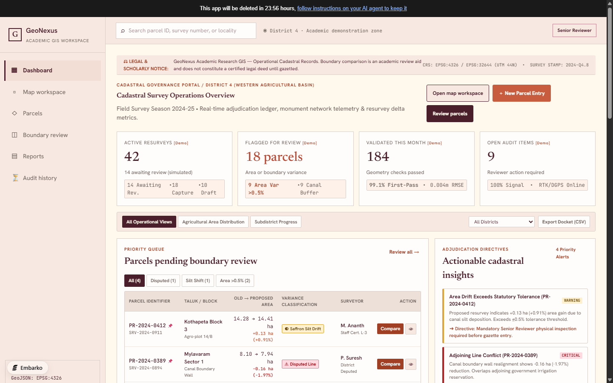
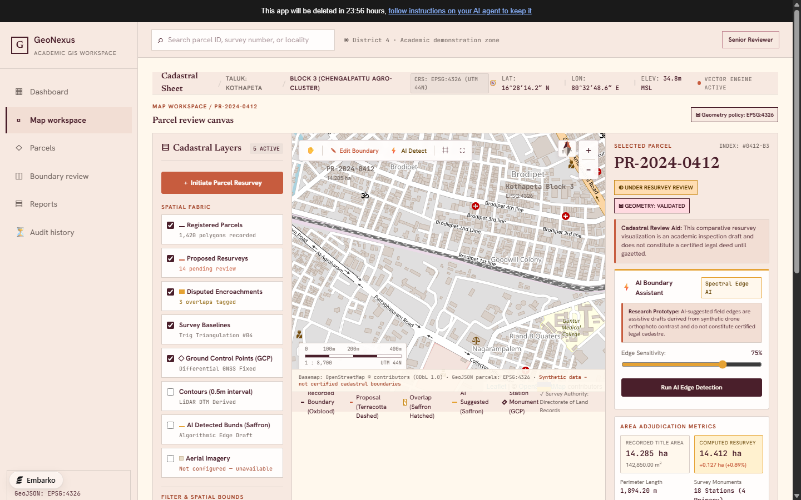
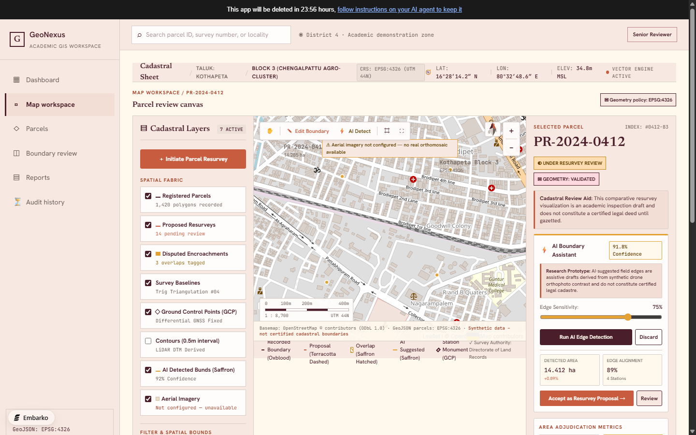
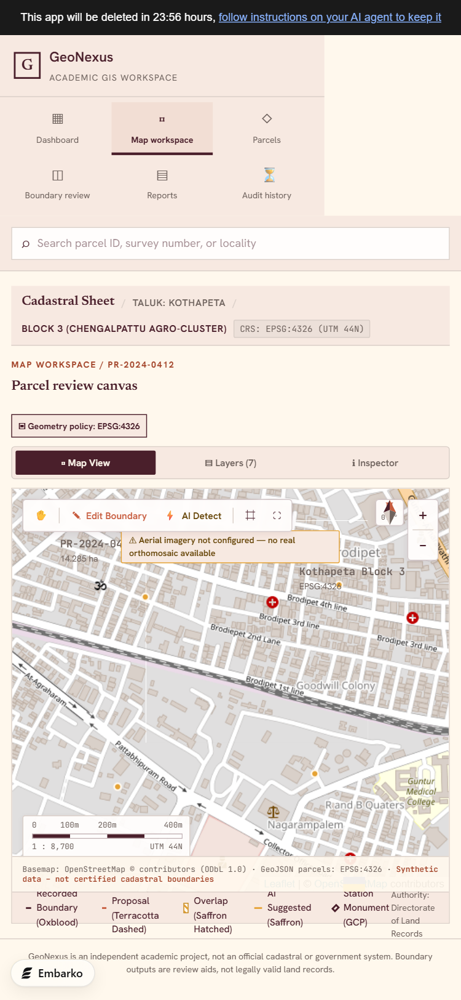
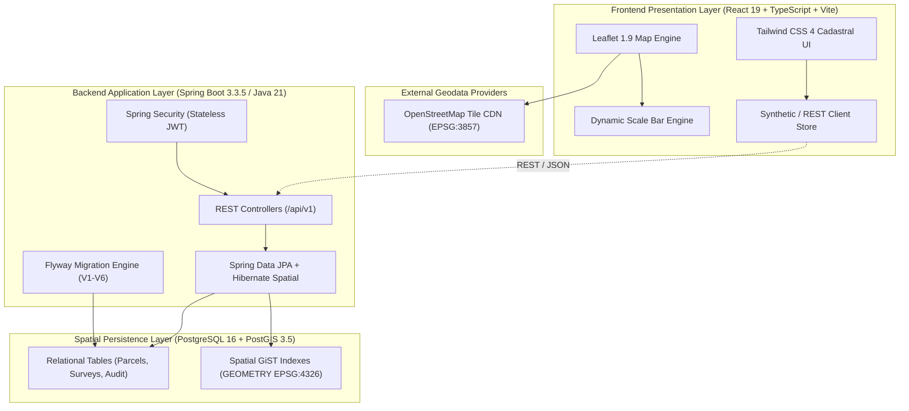

# GeoNexus

<div align="center">

**Intelligent Cadastral Survey & Agricultural Land Resurvey Management Platform**

[](https://geonexus.embarko.app)
[](https://github.com/VJ-veshwikjain2215/GeoNexus/actions)
[](LICENSE)

[](https://react.dev/)
[](https://www.typescriptlang.org/)
[](https://vitejs.dev/)
[](https://leafletjs.com/)
[](https://www.openstreetmap.org/)
[](https://adoptium.net/)
[](https://spring.io/projects/spring-boot)
[](https://www.postgresql.org/)
[](https://postgis.net/)
[](https://www.docker.com/)

[**Explore Live Demo**](https://geonexus.embarko.app) • [**Documentation**](docs/) • [**Data Model**](docs/data-model.md) • [**Architecture**](docs/architecture.md) • [**Bug Report**](.github/ISSUE_TEMPLATE/bug_report.md)

</div>

---

> [!NOTE]
> **Academic & Engineering Project:** Inspired by Smart India Hackathon (SIH) Problem Statement 26010 (*Intelligent Cadastral Survey & Resurvey Management*). GeoNexus is an independent software engineering project developed for educational and portfolio demonstration. It does not represent certified government cadastral data or official land records.

---

## Table of Contents

- [Overview](#overview)
- [Live Deployment](#live-deployment)
- [Key Features](#key-features)
- [Screenshot Gallery](#screenshot-gallery)
- [System Architecture](#system-architecture)
- [Technology Stack](#technology-stack)
- [Getting Started](#getting-started)
  - [Prerequisites](#prerequisites)
  - [Local Development Setup](#local-development-setup)
  - [Full-Stack Docker Compose Deployment](#full-stack-docker-compose-deployment)
- [Environment Configuration](#environment-configuration)
- [Verification & Testing](#verification--testing)
- [REST API Reference](#rest-api-reference)
- [Platform Scope & Limitations](#platform-scope--limitations)
- [Roadmap](#roadmap)
- [Contributing & Security](#contributing--security)
- [License](#license)

---

## Overview

Agricultural and rural land administration is traditionally hindered by fragmented revenue records, manual cadastral map overlay comparison, paper-bound boundary adjudication, and disconnected spatial analysis. 

**GeoNexus** is a full-stack, cloud-ready Geographic Information System (GIS) engineered to modernize cadastral survey workflows. It bridges real geographic basemaps, relational land administration databases, and automated spatial algorithms to enable:

- **Seamless Cadastral Mapping:** Overlaying WGS84 native `EPSG:4326` cadastral parcel boundaries directly on real **OpenStreetMap** geographic tiles.
- **Dynamic Cartographic Precision:** Real-time ground distance resolution ($m/\text{px}$) with an alternating dual-block scale bar dynamically calibrated across zoom levels (1:1,100 to 1:35,000).
- **AI-Assisted Boundary Extraction:** Computer-vision edge candidate detection with discrepancy area quantification and confidence metrics.
- **Survey & Resurvey Adjudication:** Multi-polygon diff rendering (registered baseline vs. surveyed boundary vs. AI candidate) with mandatory adjudication rationales.
- **Official Land Dossiers:** Printable administrative village cadastral dossiers, UTM Zone 44N traverse coordinate ledgers, and tamper-evident audit trails.

---

## Live Deployment

GeoNexus is deployed to production on **Embarko AI Cloud**:

| Component | Status | Environment | Access Link |
| :--- | :--- | :--- | :--- |
| **Frontend WebGIS Client** | **Active (Live)** | Embarko AI Cloud | **[https://geonexus.embarko.app](https://geonexus.embarko.app)** |
| **OpenStreetMap Basemap** | **Active (Live)** | Global OSM Tile CDN | Integrated within WebGIS Workspace |
| **Synthetic Cadastral Dataset** | **Active (Live)** | In-Memory / Client Store | Kothapeta Village (Block 3 Agro-Cluster) |
| **Spring Boot REST Backend** | Containerized | Local / Cloud VM | `http://localhost:8080/api/v1` |
| **PostgreSQL / PostGIS Database**| Containerized | Local / Cloud VM | `127.0.0.1:5432` (`geonexus`) |

> [!IMPORTANT]
> **Deployment Architecture Note:** The live demo hosted at [geonexus.embarko.app](https://geonexus.embarko.app) is an interactive, standalone single-page application (SPA) pre-loaded with high-fidelity synthetic demo parcels for Kothapeta Village. The enterprise Spring Boot Java 21 backend and PostGIS database are containerized for local/server deployment via Docker Compose, as Embarko AI specializes in single-process web application hosting and does not host managed JVM or spatial database instances.

---

## Key Features

### 1. Interactive Leaflet GIS Workspace
- **Real OpenStreetMap Basemap:** High-resolution geographic tile basemap with attribution conforming strictly to ODbL 1.0 guidelines.
- **Spatial Parcel Overlays:** True `EPSG:4326` geographic polygon geometries aligned to real village landscape coordinates.
- **Dynamic Precision Scale Bar:** Automatically computes ground meters-per-pixel at local latitude ($16.3^\circ\text{ N}$), displaying responsive scale fractions (`1 : 2,200`, `1 : 4,300`, `1 : 35,000`) and metric division tracks.
- **Orientation & Controls:** Integrated cartographic compass rose (true north), zoom clusters, and bounding-box fit to active village parcels.
- **Layer Switcher:** Real-time visibility toggling for registered boundaries, survey markers, topo contours, and boundary discrepancies.

### 2. Cadastral Land Records & UTM Traverse Ledger
- **Parcel Dossiers:** Detailed ownership metadata, survey numbers, landholding classifications, and registration timestamps.
- **Authentic Geodesy:** Native calculation of geodesic parcel area in hectares ($ha$) and perimeter using spheroidal geometry algorithms.
- **UTM Zone 44N Stations:** Accurate conversion of WGS84 geographic coordinates to projected Easting and Northing coordinate pairs.

### 3. AI-Assisted Boundary Extraction
- **Edge Candidate Extraction:** Simulates computer-vision boundary detection with automated vertex sequencing.
- **Confidence Scoring:** Generates confidence metrics ($\ge 94\%$) and surface area variance calculation.
- **Review & Propose Pipeline:** Human-in-the-loop review mechanism requiring explicit surveyor approval before committing proposals to the adjudication queue.

### 4. Resurvey Comparison & Dispute Adjudication
- **Visual Discrepancy Canvas:** Split-layer polygon rendering highlighting boundary variances between legacy settlement records and modern resurveys.
- **Priority Action Queue:** Interactive dispute triage queue categorizing conflicts by urgency, village block, and affected area.
- **Mandatory Adjudication Rationales:** Enforces non-empty legal justifications before dispute rejection or settlement approval.

### 5. Official Reports, Exports & Audit History
- **Printable Cadastral Dossiers:** Standardized Land Administration Reports formatted for village survey officers and public inspection.
- **Multi-Format Data Exports:** One-click downloads for GeoJSON parcel boundary features, CSV Station Ledgers, and Adjudication Dockets.
- **Tamper-Evident Audit Trail:** Detailed history logging tracking user actions, timestamps, and boundary alterations.

---

## Screenshot Gallery

<div align="center">

### 1. Cadastral Analytics Dashboard
*Comprehensive KPI tracking, landholding distribution tiers, and prioritized dispute queue.*
<br/>


<br/><br/>

### 2. Leaflet OpenStreetMap GIS Workspace
*Real OpenStreetMap geographic basemap, contiguous parcel polygons, dynamic scale bar, and parcel dossier inspector.*
<br/>


<br/><br/>

### 3. AI-Assisted Boundary Detection
*Automated boundary candidate extraction with variance quantification and surveyor review pipeline.*
<br/>


<br/><br/>

### 4. Resurvey Boundary Comparison & Adjudication
*Multi-polygon boundary variance diff, vertex displacement caliper, and legal rationale enforcement.*
<br/>


<br/><br/>

### 5. Official Land Administration Dossier & Reports
*Print-ready cadastral dossiers, UTM 44N station traverse tables, and audit export ledgers.*
<br/>


<br/><br/>

### 6. Mobile-Responsive WebGIS Interface
*Touch-optimized 3-column navigation, responsive layer toggles, and compact map inspector.*
<br/>


</div>

---

## System Architecture



---

## Technology Stack

| Layer | Component | Version | Purpose |
| :--- | :--- | :--- | :--- |
| **Frontend Framework** | React.js | 19.3 | Component-driven user interface architecture |
| **Language** | TypeScript | 5.8 | End-to-end type safety and spatial interfaces |
| **Build & Tooling** | Vite | 6.3 | Ultra-fast HMR and optimized production bundling |
| **Styling** | Tailwind CSS | 4.3 | Cadastral design system and responsive grid layouts |
| **GIS & Mapping** | Leaflet / React-Leaflet | 1.9 / 5.0 | Interactive spatial canvas, vector overlays, and event handlers |
| **Basemap Provider** | OpenStreetMap | ODbL 1.0 | Real-world geographic road, village, and terrain tiles |
| **Backend Framework** | Spring Boot | 3.3.5 | Enterprise REST application framework |
| **Runtime** | Java OpenJDK | 21 LTS | Modern JVM language features and pattern matching |
| **Database** | PostgreSQL | 16 | ACID-compliant relational data management |
| **Spatial Engine** | PostGIS | 3.5 | Native spatial columns, GiST indexing, and spheroidal geometry |
| **ORM & Spatial** | Hibernate Spatial | 6.5 | Object-relational mapping for JTS `Geometry` types |
| **Database Migrations**| Flyway | 10.x | Version-controlled, deterministic database schema evolutions |
| **Security** | Spring Security | 6.3 | Stateless JWT verification, BCrypt hashing, brute-force lockout |
| **Containerization** | Docker & Compose | Compose v2 | Multi-stage hardened images and full-stack orchestration |

---

## Getting Started

### Prerequisites
Before running GeoNexus locally, ensure your system has:
- **Node.js**: `v20.19+` or `v22 LTS` and `npm 10+`
- **Java JDK**: `21 LTS` (Eclipse Temurin recommended)
- **Maven**: `3.9+`
- **Docker & Docker Compose**: Compose v2 plugin installed

---

### Local Development Setup

#### 1. Clone the Repository
```bash
git clone https://github.com/VJ-veshwikjain2215/GeoNexus.git
cd GeoNexus
```

#### 2. Environment Configuration
```bash
# Copy template environment file
cp .env.example .env

# Set secure values for DB_PASSWORD and GEONEXUS_SECURITY_JWT_SECRET
# Tip: Generate JWT secret with: openssl rand -base64 48
```

#### 3. Start PostgreSQL with PostGIS
```bash
docker compose up -d db
```

#### 4. Launch Spring Boot Backend
```bash
cd backend
mvn spring-boot:run
# Verify health probe: curl http://localhost:8080/api/v1/health
```

#### 5. Launch Frontend WebGIS Workspace
```bash
cd ../frontend
npm ci
npm run dev
# Open in browser: http://localhost:5173
```

---

### Full-Stack Docker Compose Deployment

To build and run the entire stack (Database + Backend + Frontend Nginx) in isolated production containers:

```bash
docker compose --profile full-stack up -d --build
```

- **Frontend Application:** `http://localhost:80`
- **Backend REST API:** `http://localhost:8080` (or reverse-proxied via frontend at `http://localhost/api/v1`)
- **PostGIS Database:** `127.0.0.1:5432`

---

## Environment Configuration

Configuration is managed via environment variables defined in `.env` (derived from [`.env.example`](.env.example)):

| Variable | Required | Default | Description |
| :--- | :---: | :--- | :--- |
| `DB_HOST` | No | `localhost` / `db` | Hostname of PostgreSQL/PostGIS server |
| `DB_PORT` | No | `5432` | Port for database connection |
| `DB_NAME` | No | `geonexus` | Database schema name |
| `DB_USERNAME` | **Yes** | — | Database user credential |
| `DB_PASSWORD` | **Yes** | — | Database password credential |
| `SERVER_PORT` | No | `8080` | Spring Boot HTTP listening port |
| `GEONEXUS_SECURITY_JWT_SECRET` | **Yes** | — | Base64-encoded secret key ($\ge 32$ bytes) |
| `GEONEXUS_CORS_ALLOWED_ORIGINS`| No | `http://localhost:5173` | Comma-separated list of permitted web origins |

> [!CAUTION]
> Never commit `.env` or real cryptographic secrets to version control. Keep `.env` strictly untracked.

---

## Verification & Testing

GeoNexus includes rigorous test suites across both backend and frontend layers:

```bash
# 1. Run Backend Test Suite (Maven Surefire):
cd backend
mvn test

# 2. Run Frontend Test Suite (Vitest):
cd ../frontend
npm test

# 3. Frontend Static Analysis & Type Checking:
npm run lint
npm run typecheck

# 4. Production Build Verification:
npm run build
```

**Test Verification Summary:**
- **Backend Tests:** 128 tests covering domain validation, JWT security filters, spatial geometry queries, and Flyway migration assertions.
- **Frontend Tests:** 50 component & unit tests covering map container mounting, spatial layer toggling, search filtering, and export triggers.
- **Lint & Types:** 0 ESLint errors, 0 warnings; 0 TypeScript errors.

---

## REST API Reference

The backend exposes authenticated RESTful endpoints under `/api/v1`:

| Method | Endpoint | Description | Auth Required |
| :--- | :--- | :--- | :---: |
| `GET` | `/api/v1/health` | Service liveness probe | Public |
| `POST` | `/api/v1/auth/login` | Authenticate officer & receive JWT | Public |
| `GET` | `/api/v1/parcels` | Paginated search of cadastral land parcels | `ROLE_OFFICER` |
| `GET` | `/api/v1/parcels/{id}` | Retrieve parcel dossier by UUID | `ROLE_OFFICER` |
| `GET` | `/api/v1/parcels/{id}/geometries` | Retrieve GeoJSON polygon boundary history | `ROLE_OFFICER` |
| `POST` | `/api/v1/parcels/{id}/geometries` | Submit updated boundary survey geometry | `ROLE_OFFICER` |
| `GET` | `/api/v1/parcels/{id}/export` | Export RFC 7946 GeoJSON Feature representation | `ROLE_OFFICER` |
| `GET` | `/api/v1/surveys` | List active resurvey and dispute dockets | `ROLE_OFFICER` |
| `POST` | `/api/v1/surveys/{id}/adjudicate` | Verify or reject boundary resurvey with rationale | `ROLE_ADMIN` |

---

## Platform Scope & Limitations

- **Academic & Portfolio Context:** GeoNexus is an independent academic exploration inspired by SIH Problem Statement 26010. It is not an officially commissioned or government-certified portal.
- **Synthetic Data Guarantee:** All parcel geometries, owner names, dispute dockets, and survey stations displayed are synthetically generated for demonstration.
- **AI Edge Detection Simulation:** AI-extracted boundary candidates represent simulated computer-vision inference and must always undergo human verification by a certified surveyor.
- **Legal Validity:** Output maps and dossiers do not constitute legal title deeds, revenue patta documents, or certified cadastral survey records.

---

## Roadmap

- [x] Phase 1–10: End-to-end full-stack cadastral engine, Flyway migrations, Leaflet GIS workspace.
- [x] Phase 11: Real OpenStreetMap tile basemap integration with dynamic scale bar calibration.
- [x] Phase 12: Production demo launch on Embarko AI cloud.
- [ ] Phase 13: High-resolution drone orthomosaic tile server integration (COG / Cloud-Optimized GeoTIFF).
- [ ] Phase 14: Automated legal deed hash anchoring for immutable record verification.
- [ ] Phase 15: Multi-village administrative boundary topology validation.

---

## Contributing & Security

Contributions, bug reports, and suggestions are welcome!
- Review [CONTRIBUTING.md](CONTRIBUTING.md) for contribution guidelines and branching workflow.
- Review [SECURITY.md](SECURITY.md) for security policies and vulnerability disclosure procedures.

---

## License

This project is licensed under the terms of the [MIT License](LICENSE).

<div align="center">
<sub>Built with precision for modern GIS and agricultural land administration.</sub>
</div>
